# ELEC 402 - Project 3: Dot-Product Engine with ReLU, from RTL to Layout

**Midpoint submission:** December 1st, 11:59 PM - **Final deadline:** December 15th, 11:59 PM - **Weight:** 30%

---

## Introduction

Machine learning is, at its core, matrix multiplication. If you took [CPSC 340 (Machine Learning and Data Mining)](https://vancouver.calendar.ubc.ca/course-descriptions/courses/cpscv-340), you have done this many times already: the whole dataset is one matrix `X`, with one row per example and one column per feature, and a linear model is a weight vector `w`, one weight per feature. Predicting every example at once is then a single matrix-vector product, `y_hat = X w`, and fitting `w` by least squares or logistic regression is the same kind of product, repeated over and over.

A neural network is a stack of these models. Each **fully connected layer** multiplies its input vector `x` by a matrix of learned weights `W`, one row of weights per output, and passes every result through an **activation function**:

```
y = ReLU(W x)
```

Each output `y[i]` is row `i` of `W` times `x`: a weighted sum of the inputs, followed by the activation. Running a whole **batch** of inputs at once turns `x` into a matrix `X`, one input per column, and the whole layer becomes one matrix multiplication, `Y = ReLU(W X)`. Convolution layers and the attention in transformers are rearranged into the same operation. So when a model trains or runs, almost all of its arithmetic is matrix multiplication, which is why machine-learning chips (GPU tensor cores, Google's TPU) spend most of their area on multipliers and adders.

**The building block: the dot product.** Each element `C[i][j]` of `C = A x B` is the **dot product** of row `i` of `A` and column `j` of `B`: multiply the two vectors entry by entry, then add the products.

<p align="center">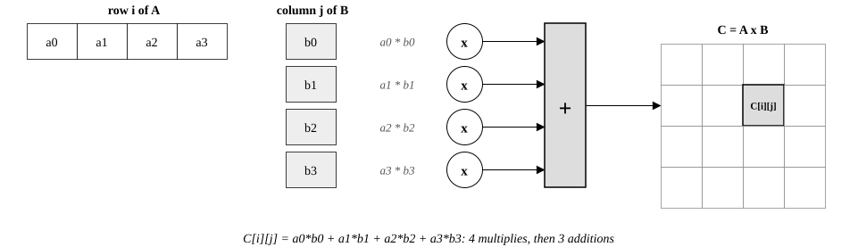</p>

With 4 entries, that is 4 multiplications and 3 additions. Every element of `C` is its own dot product, so a 4x4 `C` takes 16 of them. The hardware in this project computes one dot product every clock cycle.

### Activation functions, and why ReLU

A layer without an activation function is **linear**: each output is just a weighted sum of the inputs, `y = W x`. Linear layers have a surprising weakness: stacking them gains nothing. Feed one layer into a second and you get

<p align="center">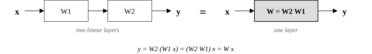</p>

`W2 W1` is itself just a matrix, so the two layers compute exactly what one layer with weights `W = W2 W1` would. The same holds for any number of layers: a hundred linear layers collapse into a matrix multiply.

That is a real limitation, because a matrix multiply can only draw **straight boundaries**. Used to classify data, it splits the inputs with a straight line (two inputs), a flat plane (three inputs) or the same flat cut in more dimensions, and nothing else. Many problems cannot be split that way. The classic small example is **XOR** of two inputs: `(0,0)` and `(1,1)` give 0, `(0,1)` and `(1,0)` give 1. Draw those four points on a grid and try to separate them: every straight line leaves a 0 and a 1 on the same side. So a linear network cannot learn XOR, however many layers it has, and real tasks such as telling a cat from a dog, or recognizing a spoken word, need boundaries far more curved than that.

An **activation function** breaks this by applying a small **non-linear** function to every output of a layer:

<p align="center">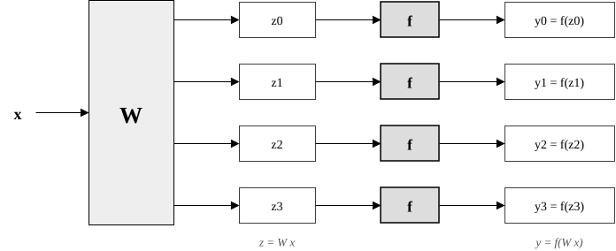</p>

The layer first computes `z = W x` as before, then passes every element of `z` through `f` separately: `y0 = f(z0)`, `y1 = f(z1)`, and so on. `f` never mixes elements together, so it is cheap: one small piece of logic per output.

Because `f` is not a straight line, the next layer can no longer be folded into this one. Each layer now bends the data a little, and many bent layers stacked together can approximate almost any function. The activation is what gives depth its value.

Many functions work. The common ones:

| Function | Formula | Notes |
|----------|---------|-------|
| Sigmoid | `1 / (1 + e^-x)` | Squashes to 0..1. Used in early networks. Needs an exponential and a divide. |
| tanh | `(e^x - e^-x) / (e^x + e^-x)` | Squashes to -1..1. Same cost problem as sigmoid. |
| **ReLU** | `max(0, x)` | Keeps positive values, replaces negative ones with 0. |
| Leaky ReLU | `x if x > 0, else 0.01 x` | Like ReLU, but lets a little of the negative side through. |
| GELU | `x * P(X <= x)`, X a standard normal | A smooth ReLU used in transformers. Needs an approximation in hardware. |

**ReLU** (rectified linear unit) is the most widely used, for three reasons:

1. **It trains well.** Sigmoid and tanh flatten out for large inputs, so their slope there is close to 0 and learning slows to a crawl (the "vanishing gradient" problem). ReLU's slope is exactly 1 for every positive input, so the learning signal passes straight through deep stacks of layers.
2. **It is sparse.** Every negative result becomes exactly 0. In a typical layer a large share of the outputs are zero, and zeros are cheap: later hardware can skip multiplies by zero entirely.
3. **It is almost free in hardware.** Sigmoid needs an exponential, a divide, or a lookup table. ReLU needs no multiplier and no adder.

The three figures below build up ReLU step by step.

**1. ReLU as a function.** Every input to the left of 0 (red) maps to 0, and every input to the right (blue) maps to itself, a straight line of slope 1. So `-5` becomes `0` and `3` stays `3`. The function is two straight pieces, but the kink at 0 is what makes it non-linear, and that kink is all a network needs.

<p align="center">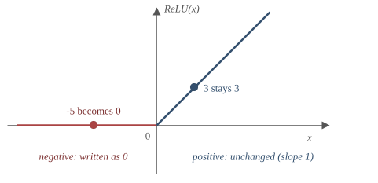</p>

**2. Applied to a matrix.** ReLU is applied to each element of `C` on its own. Here it is the result `C` from the worked example below, with `relu = 1` on every beat: the four negative sums (red) are written to memory as 0 (green), and the positive ones pass through untouched. In this project ReLU is chosen per beat, so a beat with `relu = 0` keeps its negative sum.

<p align="center">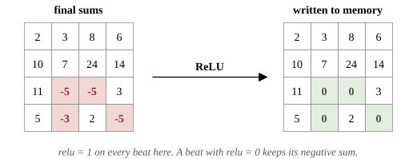</p>

**3. In hardware.** ReLU is one of the cheapest activation functions to build. It needs no multiplier and no adder: whether a result becomes 0 depends only on its sign and on the beat's `relu` bit. How you build that, and where it goes in your pipeline, is up to you.

<p align="center">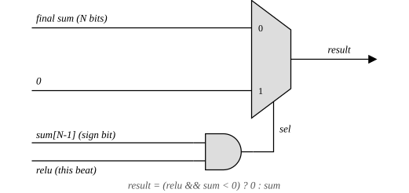</p>

One rule matters for your design: **ReLU applies to the final sum, never to partial sums.** In `a0*b0 + a1*b1 + a2*b2 + a3*b3`, an individual product, or the sum of the first two, can be negative while the full sum is positive. Clamping too early gives a wrong answer, so ReLU sits at the very end of your pipeline, after the last adder.

### This project

Real accelerators build this out of many **multiply-accumulate (MAC)** units working in parallel. Google's first TPU, for example, has a 256 x 256 grid of them (65,536 MACs) taking about a quarter of the chip, with large buffers around it to keep them fed. The hard parts are the same at any size: keep every multiplier busy every cycle, move the operands in and the results out fast enough, and close timing on a layout where real wires add delay.

In this project you build a small engine that does exactly that for 4-element vectors, and you take it all the way from RTL to a **placed and routed layout**. It reuses what you built in Project 2: the signed multiplier (four of them now), the fill/drain buffer and the handshakes. What is new is the adder tree, ReLU, real I/O timing constraints, and **place and route in Cadence Innovus**.

You will implement `mkMACBuff` in SystemVerilog. Each accepted beat brings a row of `A`, a column of `B` and a `relu` bit, and produces one result:

<p align="center">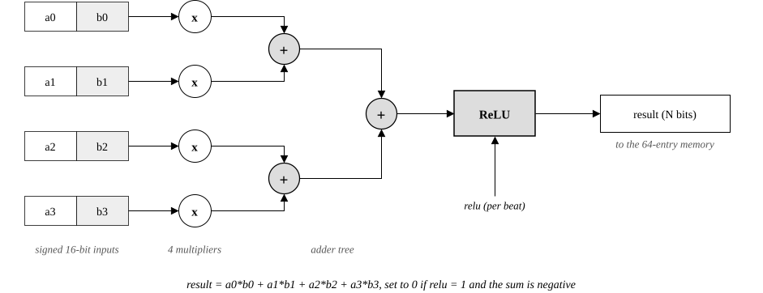</p>

Four signed 16-bit multipliers work in parallel, a small adder tree sums their products, and ReLU (if that beat's `relu` bit is 1) clamps a negative sum to 0. The result is written into a **64-entry memory**. The flow is the same shape as Project 2:

- During **fill**, each accepted beat (when `EN_mac` and `RDY_mac` are both high) sends 4 operand pairs into the pipeline. Its result lands in memory a few cycles later.
- When 64 results are stored, the memory is **full**. `RDY_mac` is low and `RDY_blockRead` rises.
- During **drain**, each accepted read (when `EN_blockRead` and `RDY_blockRead` are both high) reads the next entry, and `VALID_memVal` is high one cycle later with its result (it stays high through back-to-back reads).
- After the 64th read the memory is empty and `RDY_mac` rises again.

Either side may drop its enable at any time, which simply **pauses** the fill or the drain. Reads and writes never overlap.

There is **one target: 500 MHz** (2.0 ns clock), and one implementation in `submission/rtl/`.

The provided `bob.py` runs every tool and sources the CMC tool paths for you. The exact versions are below.

---

## Tools and versions

| Step | Tool | Version | CMC setup script (sourced by `bob.py`) |
|------|------|---------|-----------------------------------------|
| Synthesis | Cadence Genus | 20.10 | `/CMC/scripts/cadence.genus20.10.000.csh` |
| Place and route | Cadence Innovus | 21.17 | `/CMC/scripts/cadence.innovus21.17.000.csh` |
| Simulation | Siemens QuestaSim | 2022.1_2 | `/CMC/scripts/siemens.questasim.2022.1_2.csh` |


| Technology | Files |
|------------|-------|
| Process | **GPDK 45 nm**, standard cells `gsclib045` v4.4 |
| Setup corner (synthesis and setup checks) | `timing/slow_vdd1v0_basicCells.lib` |
| Hold corner (place and route) | `timing/fast_vdd1v0_basicCells.lib` |
| Physical views | `lef/gsclib045_tech.lef`, `lef/gsclib045_macro.lef` |
| Parasitics | `qrc/qx/gpdk045.tch` |
| Gate-level simulation models | `verilog/slow_vdd1v0_basicCells.v` |

All under `/ubc/ece/data/cmc2/kits/GPDK45/gsclib045_all_v4.4/gsclib045/`.

**IMPORTANT:** run every tool on `ssh-soc.ece.ubc.ca`. The other ECE servers can see the same tool folders, but these Genus and Innovus releases do not run on their operating system (`ssh-linux1`, for example, runs Ubuntu 24.04). `bob.py` needs Python 3.6 or newer, and the `python3` on ssh-soc is new enough.

---

## Module interface

The starter skeleton is in `starter/rtl/mkMACBuff.sv`. Copy it to `submission/rtl/` and implement it there. The port list below is the **complete** interface.

```Verilog
module mkMACBuff #(parameter N = ...) ( // N: the result width, you derive it
    input logic clk,
    input logic RST_N, // active-low synchronous reset

    // MAC / write side
    input logic EN_mac,
    input logic [15:0] mac_a0, mac_a1, mac_a2, mac_a3, // row of A (signed)
    input logic [15:0] mac_b0, mac_b1, mac_b2, mac_b3, // column of B (signed)
    input logic relu,
    output logic RDY_mac,

    // Read / drain side
    input logic EN_blockRead,
    output logic RDY_blockRead,
    output logic VALID_memVal,
    output logic [N-1:0] memVal_data,

    // Memory ports: the TESTBENCH connects these to memory_wrapper_2port.
    // Do NOT instantiate the memory inside mkMACBuff.
    output logic EN_writeMem,
    output logic [5:0] writeMem_addr,
    output logic [N-1:0] writeMem_val,

    output logic EN_readMem,
    output logic [5:0] readMem_addr,
    input logic [N-1:0] readMem_val
);
```

### Signal summary

| Signal | Description |
|--------|-------------|
| `EN_mac` | Input from the producer: high when it has a beat (4 operand pairs) to send. |
| `RDY_mac` | Output: high when the engine can accept a beat. A beat is accepted when `EN_mac` and `RDY_mac` are both high. |
| `mac_a0..mac_a3`, `mac_b0..mac_b3` | Signed 16-bit operands. Lane `k` multiplies `mac_ak` by `mac_bk`. |
| `relu` | Part of the beat, like the operands. If it is 1 on an accepted beat, that beat's result is clamped to 0 when negative. Each beat has its own `relu`, so ReLU can change on every beat. |
| `EN_blockRead` / `RDY_blockRead` | Read handshake. A read is accepted when both are high. |
| `VALID_memVal` / `memVal_data` | A drained result, valid exactly 1 cycle after its address is presented to the memory. |
| `EN_writeMem`, `writeMem_addr`, `writeMem_val` | Write port: a finished result is written to the next free slot. |
| `EN_readMem`, `readMem_addr`, `readMem_val` | Read port: each accepted read presents the next address (0..63 in order). |

In this document, a **beat** means one dot product's worth of inputs: all four `mac_a`, all four `mac_b` and `relu`, taken together on one rising clock edge, the edge where `EN_mac` and `RDY_mac` are both 1.

---

## Design requirements

### 1. The dot product

Each accepted beat computes the **signed** sum `a0*b0 + a1*b1 + a2*b2 + a3*b3`. A new beat can be accepted every cycle, and every accepted beat produces exactly one memory write, in order.

**Width: you derive `N`.** `N` is the width of a result, and of every memory entry. It is not given: work out the smallest `N` that holds every possible result exactly, with **no overflow**, set it in your `mkMACBuff`, your testbenches and your memory instance, and **state and justify it in your report**.

Think about the extremes: a signed 16x16 product fits in 32 bits (Project 2), but what is the largest and the most negative value the **sum of four** products can reach, and which operands produce them? How many bits does a signed number need to hold that range? A result that overflows `N` bits wraps around to a wrong value (a large positive sum can come out negative, and ReLU then clamps it to 0). Our grader checks the full range, so a width that is one bit short will fail on the corner cases.

The grader instantiates `mkMACBuff` **without** setting `N`, so the default in your RTL is what is tested. A width that is too small compiles, but fails the corner cases. A width larger than needed gives correct results, but every extra bit costs **10% of the entire project mark**, down to 0.


### 2. Reusing your Project 2 multiplier

As in the Project 2 spec, you may start from the pipelined multiplier you took through synthesis in Project 2. Change it as this project needs (the 500 MHz clock, the new I/O constraints, four copies of it, an adder tree after them), and this time take it all the way through place and route. The same pipelining rules apply:

- The pipeline stages must be in **your RTL**: you split the multipliers and the adder tree into stages yourself.
- You may **not** write a single behavioural 16b x 16b multiply (`a * b` on 16-bit operands), add empty register stages after it, and let retiming or the tool build the pipeline for you.
- No `*` on an operand wider than 8 bits, so 8x8 partial products are fine and 16x8 is not.
- The adder tree may use `+`.
- No explicit instantiation of DesignWare or ChipWare components. Write the arithmetic yourself. (Genus maps your `+` onto its own adders internally, and that is fine.)
- Smaller multiplies (for example 8b x 8b partial products) inside your own pipeline are fine.
- Retiming is allowed, but only to rebalance stages you designed yourself.

### 3. ReLU

ReLU applies to the **final** sum only, never to partial sums. A partial sum can be negative while the final result is positive. With ReLU off, results are written as they are.

<p align="center">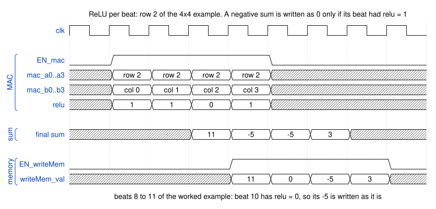</p>

`relu` belongs to its beat, just like `mac_a0..a3` and `mac_b0..b3`: each result uses the `relu` of the beat that produced it. So ReLU can be switched for every element of `C`, for example only for some of its columns. Your design has to carry each beat's `relu` bit down the pipeline so it meets that beat's final sum.

### 4. Memory, fill, drain and reset

The memory belongs to the testbench, `RDY_mac` must account for beats still in the pipeline, the memory is read only after it is full, and `RST_N` (synchronous, active low) returns everything to empty and idle. Use a synchronous reset on every register.

During and right after reset: `RDY_mac` = 1, `RDY_blockRead` = 0, `VALID_memVal` = 0, `EN_writeMem` = 0 and `EN_readMem` = 0.


---

## Worked example: a 4x4 matrix multiply

<p align="center">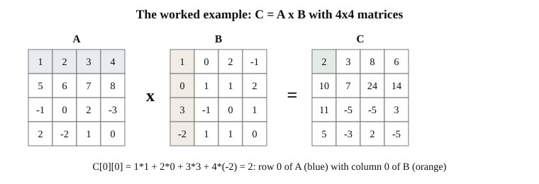</p>

Element `C[i][j]` is one beat: row `i` of `A` on `mac_a0..3`, column `j` of `B` on `mac_b0..3`. The animation steps through all 16 beats, one element of `C` per beat, with ReLU applied as each result is written: a negative sum becomes 0 when that beat's `relu` is 1. Beat 10 has `relu = 0`, so its negative sum is written unchanged.

<p align="center">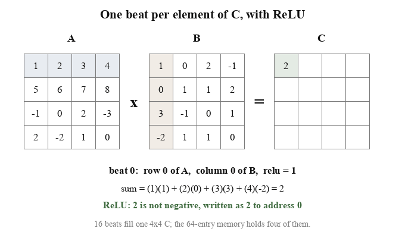</p>

| Beat | `mac_a0..3` (row of A) | `mac_b0..3` (column of B) | `relu` | Sum | Written to memory |
|------|------------------------|---------------------------|--------|-----|-------------------|
| 0 | 1, 2, 3, 4 | 1, 0, 3, -2 | 1 | `1 + 0 + 9 - 8 = 2` | 2 at addr 0 = `C[0][0]` |
| 1 | 1, 2, 3, 4 | 0, 1, -1, 1 | 1 | 3 | 3 at addr 1 = `C[0][1]` |
| 2 | 1, 2, 3, 4 | 2, 1, 0, 1 | 1 | 8 | 8 at addr 2 = `C[0][2]` |
| ... | | | | | |
| 9 | -1, 0, 2, -3 | 0, 1, -1, 1 | 1 | -5 | **0** at addr 9 = `C[2][1]` (ReLU) |
| 10 | -1, 0, 2, -3 | 2, 1, 0, 1 | 0 | -5 | -5 at addr 10 = `C[2][2]` (ReLU off for this beat) |
| ... | | | | | |
| 15 | 2, -2, 1, 0 | -1, 2, 1, 0 | 1 | -5 | **0** at addr 15 = `C[3][3]` (ReLU) |

16 beats give one full `C`, so the 64-entry memory holds exactly **four** 4x4 results.

With **ReLU on**, the negative results become 0. Row 2 of `C` is stored as `11, 0, -5, 3` (beat 10 has `relu = 0`, so it keeps its -5) and row 3 as `5, 0, 2, 0`.

---

## Timing diagrams

The diagrams in this section use a 2-stage pipeline to keep them short. Your design will have more stages, so its results reach memory later, but the handshakes are the same. The checker testbench waits on the handshake and valid signals rather than counting cycles, so it works with any pipeline depth. Each beat is labelled with the element of `C` it computes, as in the 4x4 worked example.

### 1. Fill - results land in memory

**What one beat is.** A beat is one dot product's worth of inputs: all four `mac_a`, all four `mac_b` and `relu`, taken together on one rising clock edge, the edge where `EN_mac` and `RDY_mac` are both 1. On any other edge the inputs are not a beat.

<p align="center">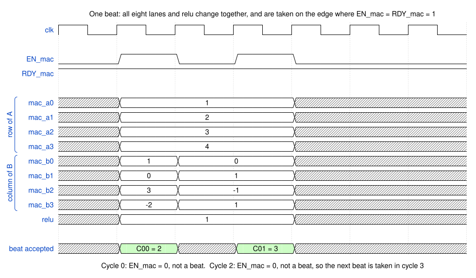</p>

**Beats in a row.** `EN_writeMem` fires when a beat's result leaves the last pipeline stage, and `writeMem_addr` walks up 0, 1, 2, ...

<p align="center">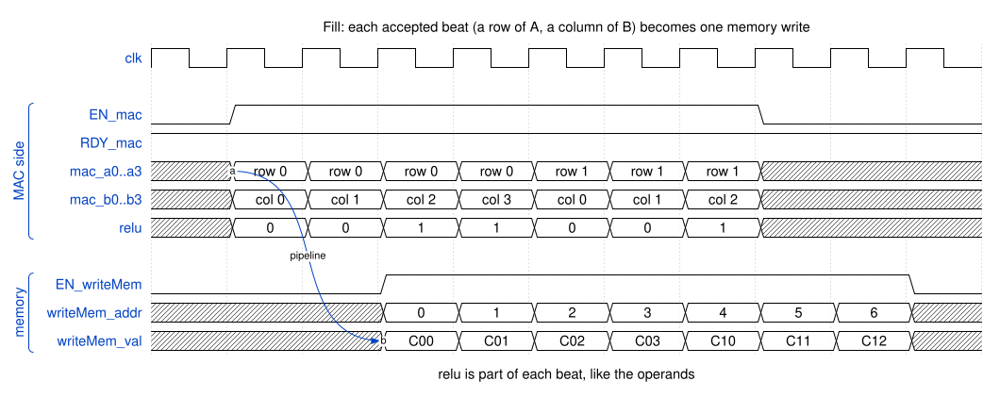</p>

**Pauses.** `EN_mac` can drop at any time. A cycle with `EN_mac = 0` is not a beat: nothing is written for it, the next beat's result goes to the next address, and results always come out in the order the beats went in.

<p align="center">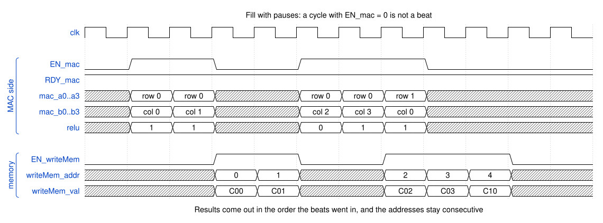</p>

**Where ReLU applies.** `relu` acts on the beat's final N-bit sum, after all four products have been added, not on the individual products or on a partial sum.

### 2. Full - `RDY_mac` drops, `RDY_blockRead` rises

`RDY_mac` drops while results are still in the pipeline, so that every accepted beat still has a slot. Once the 64th result lands, `RDY_blockRead` rises.

<p align="center">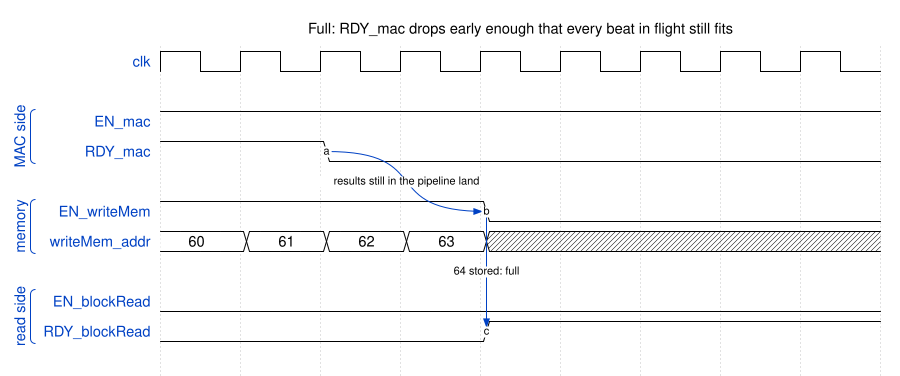</p>

### 3. Drain - sequential read-out

Each accepted read presents the next address. `VALID_memVal` and `memVal_data` follow one cycle later, because the memory read is registered. Dropping `EN_blockRead` pauses the drain.

<p align="center">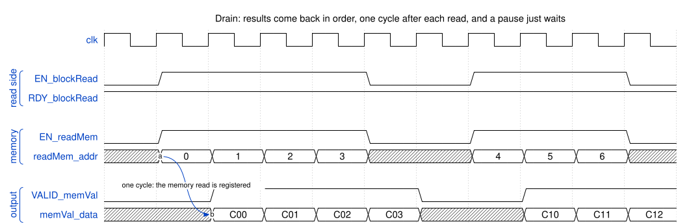</p>

### 4. End of drain - memory empties

After the 64th read `RDY_blockRead` drops, the memory is empty, and `RDY_mac` rises for the next fill.

<p align="center">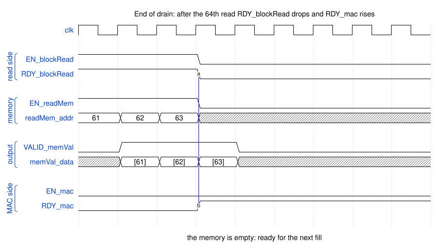</p>

### 5. Walkthrough: one complete run

The animation below plays a whole run, cycle by cycle, with a 2-stage pipeline as the example: reset, a complete fill of 64 beats (with pauses, and ReLU switched per beat), full, a complete read of all 64 results (with pauses), and the start of the next fill. It moves quickly through the routine cycles and slows down at every transition, with a caption saying what just happened. The bar under the waveform shows where you are in the run.

Watch for:

- **A pause in the fill:** `EN_mac` drops, no beat is accepted, but the beats already in the pipeline still land.
- **ReLU per beat:** compare `final sum` with `writeMem_val`. A negative sum becomes 0 only when its beat had `relu = 1`.
- **Full:** `RDY_mac` drops early, while results are still in flight, and `RDY_blockRead` rises once all 64 have landed.
- **A pause in the read:** `EN_blockRead` drops and the read waits, with nothing skipped.
- **Empty:** after the 64th read, `RDY_blockRead` drops and `RDY_mac` rises for the next fill.

<p align="center">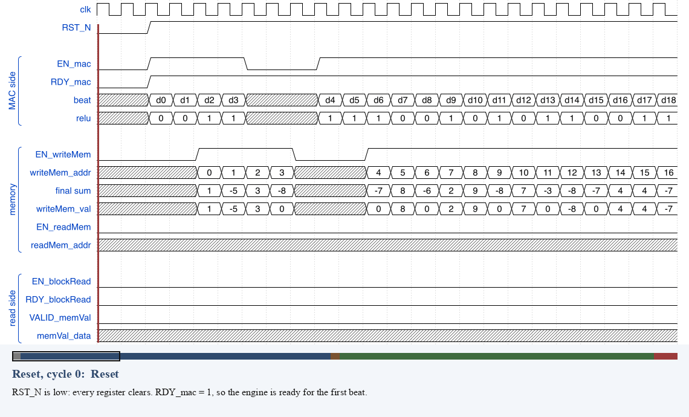</p>

---

## Synthesis

### What you need to do

1. **Copy the script template.** `starter/scripts/synth.tcl` has the same layout as in Project 2: it handles file reading, report names and output files, and leaves the clock, the constraints, the synthesis steps and the `synth_run` call to you. Copy it into your submission and edit the copy:

   ```bash
   cp starter/scripts/synth.tcl submission/scripts/synth.tcl
   ```

2. **Apply the constraints** below in TODO 1-3, and write the synthesis steps in TODO 4.
3. **Set the reporting clock** in TODO 5. Re-creating the clock drops every constraint that refers to it (the I/O delays, latency and uncertainty), so apply them again.
4. **Add the arguments `synth_run` needs** in TODO 0, then **call it** in TODO 6. Its `tag` is the target frequency, `500`, and names the output files. `bob.py` sets `RUN_TAG` and then runs the script, as in Project 2.
5. **Synthesize:** `python3 bob.py synth --run 500`. Reports go to `submission/syn_reports/`, the netlist, SDF, SDC and Genus database to `submission/outputs/` (`mkMACBuff_500_map.sv`, `.sdf`, `.sdc`, `mkMACBuff_synth_500.dat`).
6. **Check the reports.** **Required:** no negative slack (WNS >= 0 ps) at 2.0 ns. Look at `mkMACBuff_500_timing_in.rpt` and `mkMACBuff_500_timing_out.rpt` too: the input and output paths now have real budgets.

   **Recommended, not graded:** leave at least 10% of the clock period as slack after synthesis (WNS >= 200 ps at 2.0 ns). Synthesis times your design with estimated wires and an ideal clock. Place and route replaces both with the real thing: cells are spread out and connected by real wires with resistance and capacitance, the ideal clock becomes a clock tree with real skew, hold fixing inserts buffers, and neighbouring wires couple through crosstalk. Every one of these eats into your slack. A design that only just meets timing after synthesis almost always fails after routing, and then the fix is back in the RTL. Synthesizing a little tighter than 2.0 ns (TODO 0 and 6) is the easiest way to buy that margin.
7. **Check the netlist** with your SDF testbench: `python3 bob.py timing --run 500 --stage syn`.

### Constraints

Apply these in TODO 1-3, and again after re-creating the clock in TODO 5.

- Clock on `clk`, period 2.0 ns for the reports (you may synthesize a little tighter).
- **Clock network latency and uncertainty: 1/8 of the period** each.
- Minimum-sized D flip-flops (`DFFX1`) drive every input. **Input transition: 1/8 of the period.**
- All outputs drive 4x the capacitance of pin A of `NAND2X4`.
- **Input and output delays: 1/4 of the period** on every input except `clk` and `RST_N`, and on every output. Input-to-flop and flop-to-output paths must settle within 3/4 of the cycle, so register your operands early.
- **Maximum fanout of 4** on the input nets.
- Do **not** synthesize `memory_wrapper_2port`.

Area limit: at most **50,000 um^2** total cell area after place and route (`mkMACBuff_500_area.rpt`). A design over the limit receives **0** for area. For scale, the staff design is about 35,200 um^2.

---

## Place and route

Place and route turns your synthesized netlist into a layout: where every cell sits, how power reaches it, where the pins are, and how every wire is routed.

### What you need to do

1. **Copy the script template** and fill in its TODOs. It follows the same layout as `synth.tcl`: each stage is a small proc, `pnr_run` calls them in order, and you call `pnr_run` at the bottom (TODO 9), using `RUN_TAG` the same way.

   ```bash
   cp starter/scripts/pnr.tcl submission/scripts/pnr.tcl
   ```

2. **Run it one stage at a time** and look at each stage in the GUI before you go on, as in [Stage by stage](#stage-by-stage-run-it-open-it-check-it) below. Every stage saves a checkpoint in `submission/pnr_outputs/checkpoints/` when it finishes, and the next stage starts from it. So if routing fails, fix `pnr::route` and run `--stage route` again, without redoing placement and CTS.

3. **When every stage works, run them all at once:**

   ```bash
   python3 bob.py pnr --run 500
   ```

   Reports go to `submission/pnr_reports/`, the post-layout netlist and SDF to `submission/pnr_outputs/` (`mkMACBuff_500_pnr.v`, `.sdf`), and a checkpoint of every stage to `submission/pnr_outputs/checkpoints/` (`mkMACBuff_500_<stage>.enc` and its folder `mkMACBuff_500_<stage>.enc.dat/`, about 110 MB for all nine). **Submit all nine checkpoints** (import, floorplan, power, pins, place, cts, route, fill and verify): we open them to check each stage of your layout.

4. **Check DRC, connectivity and antennas** (see [Checking DRC](#checking-drc)), then **simulate the post-layout netlist:**

   ```bash
   python3 bob.py timing --run 500 --stage pnr
   ```

### Opening the Innovus GUI

1. **Off campus? Connect to the UBC VPN first** (myVPN / Cisco Secure Client). `ssh-soc.ece.ubc.ca` is not reachable from outside UBC without it.

2. **Log in with a GUI connection.** Pick one:

   | Way | How | Speed |
   |-----|-----|-------|
   | X2Go | New session to `ssh-soc.ece.ubc.ca`: single application `xterm`, connection speed `ADSL`, compression `16m-jpeg`, quality `5` (set-up steps in [docs/REMOTE_GUI.md](docs/REMOTE_GUI.md)) | fast, about 0.35 s per redraw |
   | `ssh -Y -C` | `ssh -Y -C -c aes128-gcm@openssh.com <username>@ssh-soc.ece.ubc.ca` (needs XQuartz on macOS, MobaXterm on Windows) | slow, about 1.3 s per redraw (3.1 s without `-C`) |

   With `ssh -Y`, check that the GUI can reach your screen: `echo $DISPLAY` must print something like `localhost:10.0`. If it prints nothing, your ssh config is probably sharing one connection between terminals: connect with `ssh -Y -C -o ControlMaster=no ...` instead.

3. **Go to your repository and start Innovus 21.17**, the same version `bob.py` runs.

   ```bash
   cd ~/elec402-p3-2026-<firstname><lastname>
   source /CMC/scripts/cadence.innovus21.17.000.csh
   innovus
   ```

4. **Load a checkpoint** at the `innovus>` prompt (each stage below gives the exact line), then press **`f`** in the layout window to fit the whole die on the screen.

5. **Quit with `exit`** when you are done, so Innovus does not keep running on the server.

#### Keeping the GUI fast

| Do this | Why |
|---------|-----|
| Run the stages with `bob.py` and only *look* at the checkpoints in the GUI | Placement and routing take as long in the GUI, and the GUI also redraws after every step |
| Use X2Go (ADSL, 16m-jpeg, quality 5) rather than `ssh -Y` | About 9 times faster than plain `ssh -Y` and 3.6 times faster than `ssh -Y -C` in our test: X2Go sends compressed pictures, `ssh -Y` every drawing command |
| Untick the layers you are not looking at (layer panel on the right) | Every visible shape has to be drawn |
| Turn off instance and pin names | They are thousands of small text objects |
| Zoom into a region (right-drag a box) instead of redrawing the whole die | Less to draw |
| Close the timing and report windows you are not using | Each one keeps redrawing |

### Finding your way around the GUI

**The console.** Innovus has no command line of its own inside the window: the `innovus>` prompt is in the terminal you started it from. Every command in this document (`restoreDesign`, `verify_drc`, `ctd_win`, ...) is typed there, and its output is printed there.

<p align="center">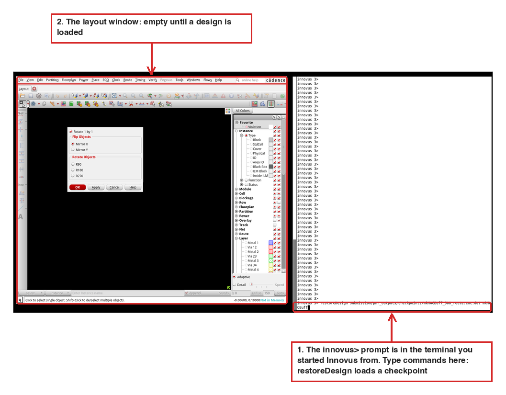</p>

**Show and hide things.** The panel on the right lists everything that can be drawn. Hiding what you do not need makes the picture clearer and the GUI faster.

<p align="center">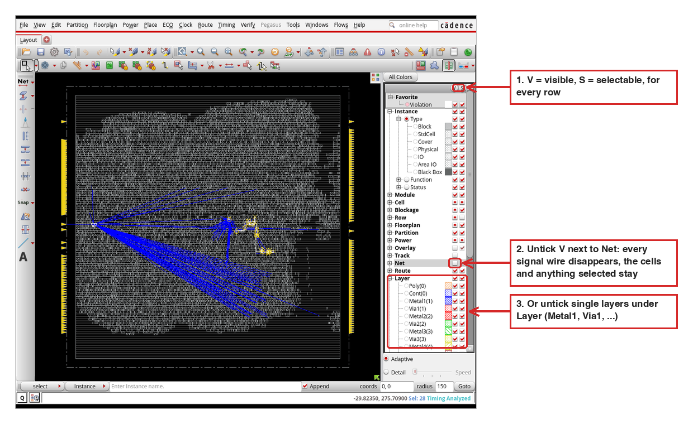</p>

**Zoom.** Drag a box with the right mouse button to zoom into it, press `f` to fit the whole die again.

<p align="center">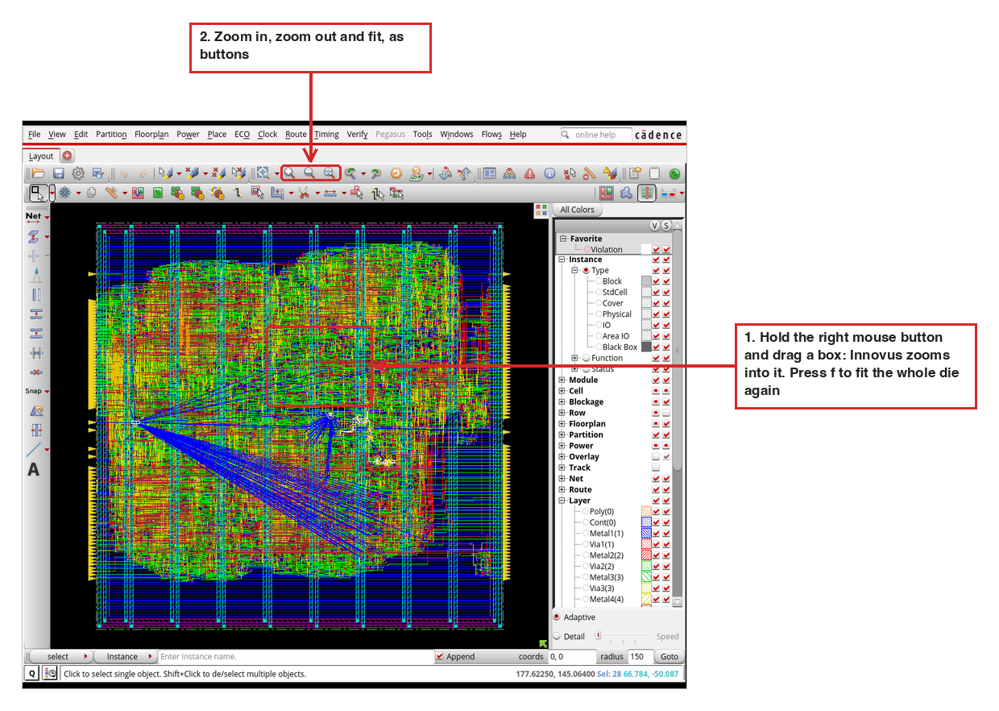</p>

**Select and inspect.** Click a cell to select it, then press `q` to see everything about it.

<p align="center">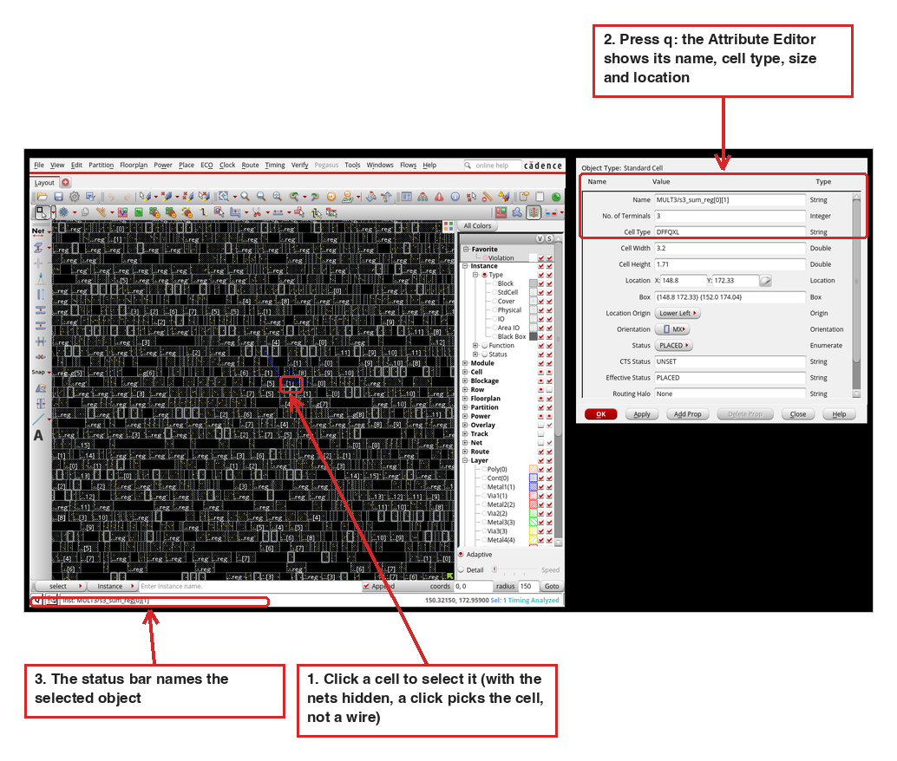</p>

**Measure.** Press `k` and click two points for a ruler.

<p align="center">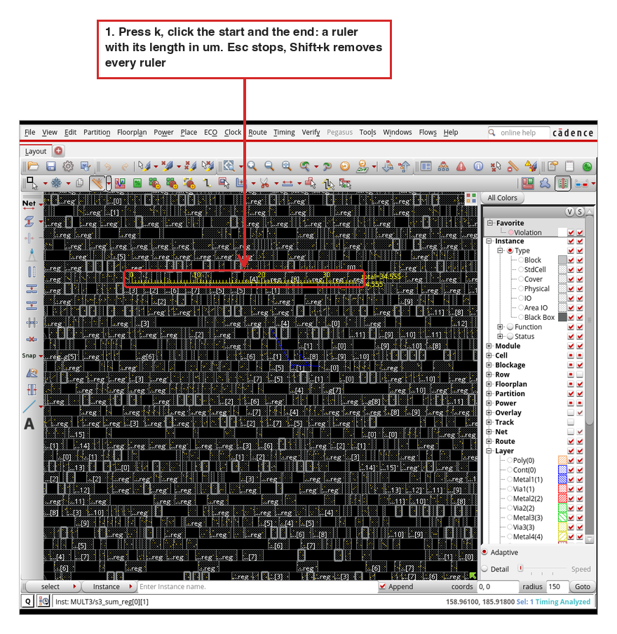</p>

| Key | Does |
|-----|------|
| `f` | Fit the whole die in the window |
| Right-drag | Zoom into a box |
| `z` / `Z` | Zoom in / out |
| Click, Shift+click | Select, add to the selection |
| `q` | Attribute Editor for the selected object |
| `k` / `K` | Ruler / remove every ruler |
| `Esc` | Stop the current command |

### Stage by stage: run it, open it, check it

Each stage is one `bob.py` command, then one line in the GUI to see the result. The pictures are from the reference design (263 x 263 um, with the core 8 um inside the die on every side, marked with Innovus rulers). Yours will differ in size and detail, but should have the same features.

| # | Stage | Proc | What it does |
|---|-------|------|--------------|
| 1 | `import` | `pnr::import` (given) | Reads the netlist, the libraries and your SDC |
| 2 | `floorplan` | `pnr::floorplan` | Die and core size |
| 3 | `power` | `pnr::power` | Power ring, stripes and cell rails |
| 4 | `pins` | `pnr::pins` | Pin locations |
| 5 | `place` | `pnr::place` | Places the cells, optimizes before CTS |
| 6 | `cts` | `pnr::cts` | Builds the clock tree |
| 7 | `route` | `pnr::route` | Routes every net, optimizes after routing |
| 8 | `fill` | `pnr::fill` | Fills the empty space in the core, repairs DRC |
| 9 | `verify` | `pnr::verify` (given) | DRC, connectivity and antenna checks |
| 10 | `finish` | `pnr::finish` (given) | Reports, netlist, SDF, saved design |

#### 1. Import

```bash
python3 bob.py pnr --run 500 --stage import
```

Open it in the GUI:

```tcl
restoreDesign submission/pnr_outputs/checkpoints/mkMACBuff_500_import.enc.dat mkMACBuff
```

**Check:** the log (`submission/pnr_logs/`) has no `**ERROR`, and the GUI opens the design with no cells placed yet.


#### 2. Floorplan

```bash
python3 bob.py pnr --run 500 --stage floorplan
```

Open it in the GUI:

```tcl
restoreDesign submission/pnr_outputs/checkpoints/mkMACBuff_500_floorplan.enc.dat mkMACBuff
```

**Check:** a square die, with the core 8 um inside it on every side, and empty standard-cell rows.

<p align="center">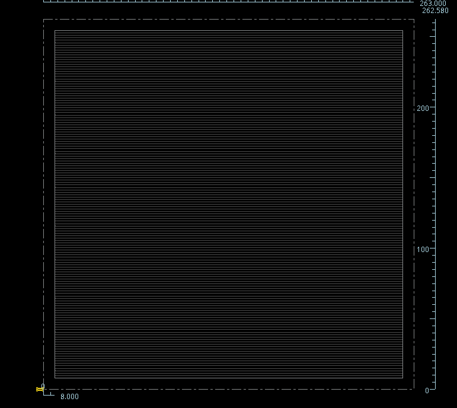</p>

#### 3. Power

```bash
python3 bob.py pnr --run 500 --stage power
```

Open it in the GUI:

```tcl
restoreDesign submission/pnr_outputs/checkpoints/mkMACBuff_500_power.enc.dat mkMACBuff
```

**Check:** the VDD / VSS ring on Metal7 / Metal8 in the gap around the core, the vertical stripes across it, and a power rail along every row.

<p align="center">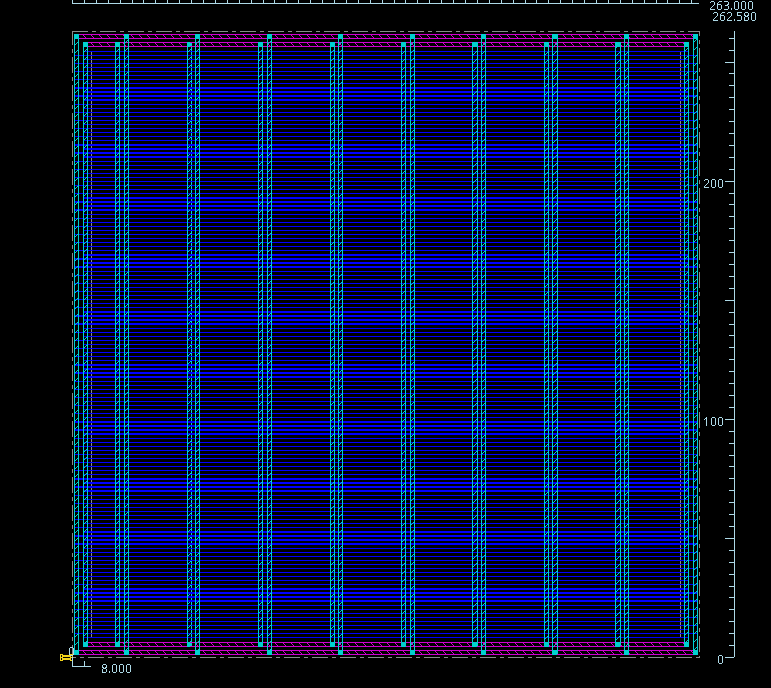</p>

#### 4. Pins

```bash
python3 bob.py pnr --run 500 --stage pins
```

Open it in the GUI:

```tcl
restoreDesign submission/pnr_outputs/checkpoints/mkMACBuff_500_pins.enc.dat mkMACBuff
```

**Check:** the pins grouped by interface, the mac, blockRead and memVal interfaces on the left edge and the writeMem and readMem interfaces on the right, over the middle 80% of each edge, as in the labelled picture under [Requirements](#requirements).

<p align="center">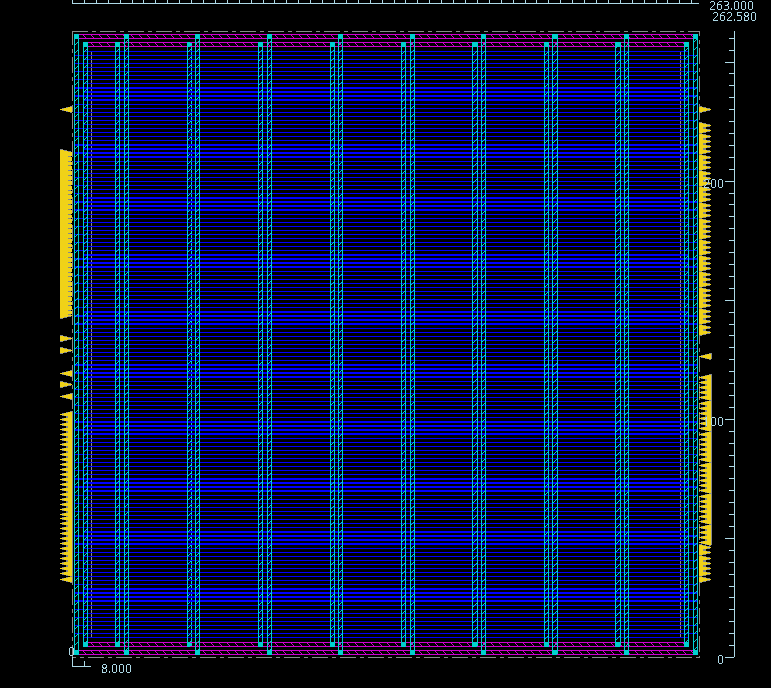</p>

#### 5. Placement

```bash
python3 bob.py pnr --run 500 --stage place
```

Timing after placement is in `submission/pnr_reports/preCTS/`. If setup WNS is worse than -100 ps, lower the utilization and run `--stage floorplan` onwards again.

Open it in the GUI:

```tcl
restoreDesign submission/pnr_outputs/checkpoints/mkMACBuff_500_place.enc.dat mkMACBuff
```

**Check:** the cells spread across the rows, between the input and the output pins. The lines are early estimates of the routing.

<p align="center">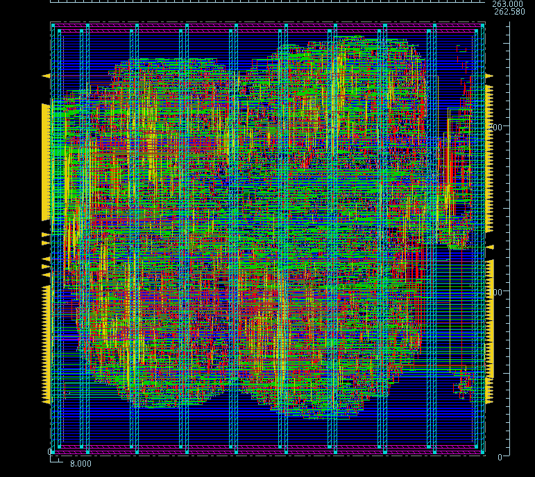</p>

#### 6. Clock tree (CTS)

```bash
python3 bob.py pnr --run 500 --stage cts
```

The clock tree reports are `submission/pnr_reports/mkMACBuff_500_clock_trees.rpt` and `_skew_groups.rpt`, timing after CTS is in `postCTS/`.

Open it in the GUI:

```tcl
restoreDesign submission/pnr_outputs/checkpoints/mkMACBuff_500_cts.enc.dat mkMACBuff
```

**Check:** the clock tree, in the layout and in the Clock Tree Debugger.

**The clock net, before and after CTS.** Before CTS, `clk` is one ideal net: the pin drives every flip-flop directly, with no buffers and no real routing. After CTS, Innovus has built a tree of clock buffers that delivers the clock to every flip-flop at nearly the same time (the highlighted nets).

<table align="center">
<tr><th>Before CTS (<code>place</code> checkpoint)</th><th>After CTS (<code>cts</code> checkpoint)</th></tr>
<tr>
<td>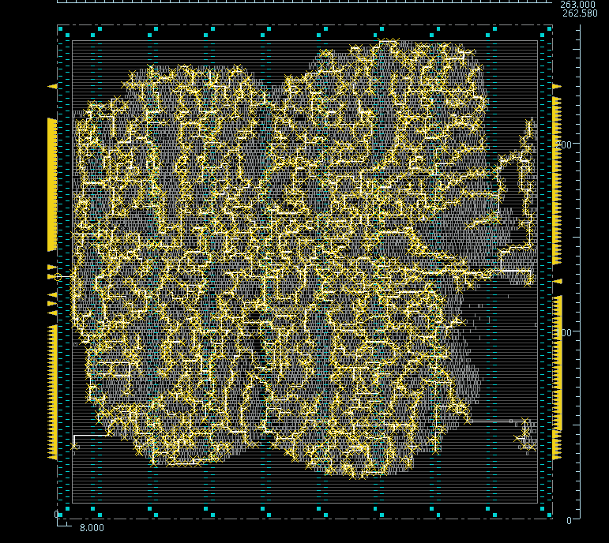</td>
<td></td>
</tr>
</table>

**The Clock Tree Debugger** draws the clock as a tree, with the clock arrival time on the vertical axis. To open it:

**Step 1.** In the menu bar, click **Clock**, then **CCOpt Clock Tree Debugger...**

<p align="center">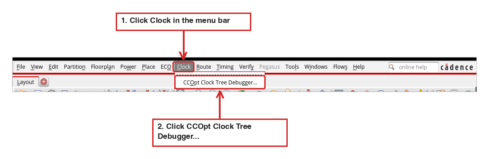</p>

**Step 2.** A small **CTD Configuration** window opens. Tick **Unit Delay Mode** before CTS, when there is no real tree yet (it draws the tree by level). Leave it off after CTS (it draws by arrival time). Click **OK**.

<p align="center">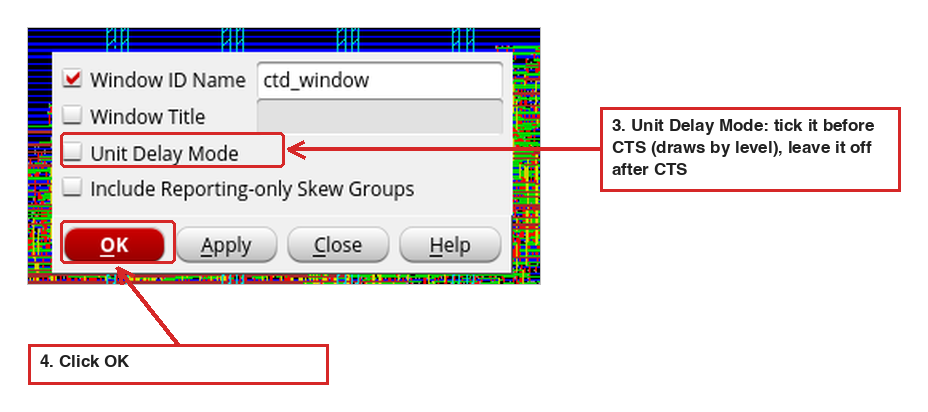</p>

**Step 3.** The debugger opens on top of the layout.

<p align="center">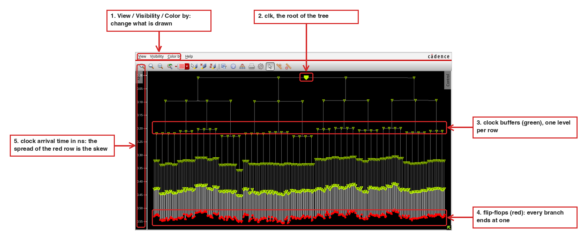</p>

You can also skip the menu and type `ctd_win` (or `ctd_win -unit_delay`) at the `innovus>` prompt.

**Before CTS** (`place` checkpoint, Unit Delay Mode on), there is no tree at all: `clk` drives all of the flip-flops (red, along the bottom) directly, one huge fanout.

<p align="center">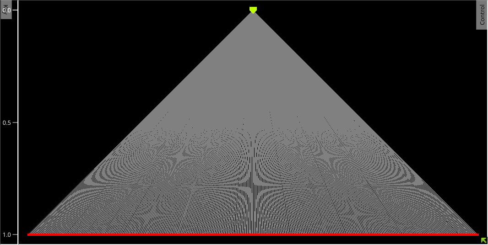</p>

**After CTS** (`cts` checkpoint), `clk` at the top drives levels of clock buffers (green) down to the flip-flops, which all receive the clock at about 0.50 to 0.55 ns. That spread is the **clock skew**, and the time itself is the **insertion delay** (the latency) the tool reports.

<p align="center">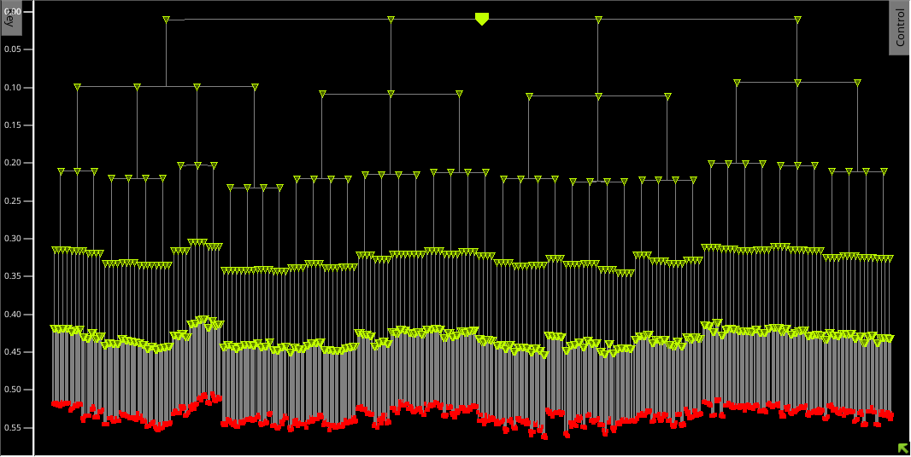</p>

#### 7. Routing

```bash
python3 bob.py pnr --run 500 --stage route
```

Setup and hold after routing are in `submission/pnr_reports/postRoute/` and `postRoute_hold/`.

Open it in the GUI:

```tcl
restoreDesign submission/pnr_outputs/checkpoints/mkMACBuff_500_route.enc.dat mkMACBuff
```

**Check:** every net routed, on the metal layers up to Metal10.

<p align="center">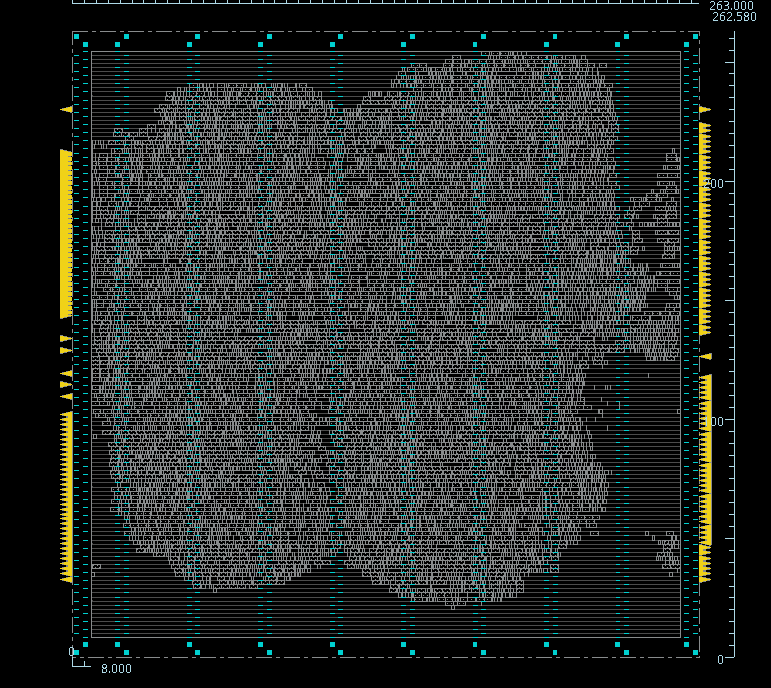</p>

#### 8. Fillers

```bash
python3 bob.py pnr --run 500 --stage fill
```

Open it in the GUI:

```tcl
restoreDesign submission/pnr_outputs/checkpoints/mkMACBuff_500_fill.enc.dat mkMACBuff
```

**Check:** every row filled, with no gaps. The second picture is the same layout with the routing layers turned off.

<p align="center">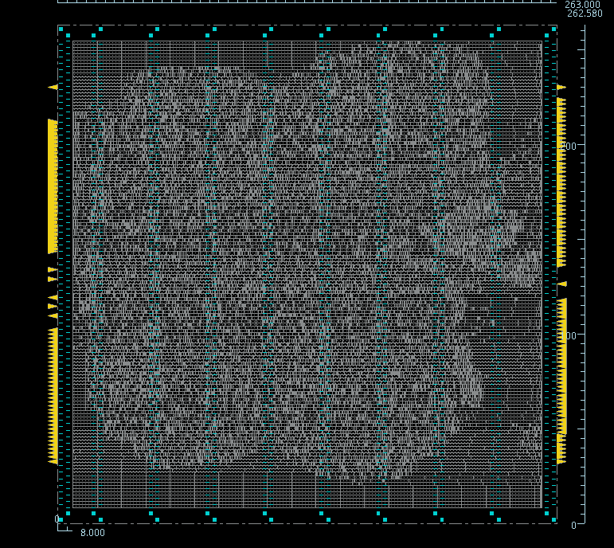</p>

<p align="center">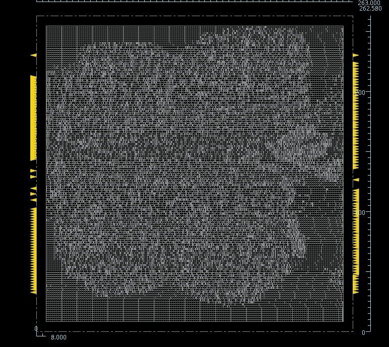</p>

#### 9. Verify

```bash
python3 bob.py pnr --run 500 --stage verify
```

Runs the DRC, connectivity and antenna checks. See [Checking DRC](#checking-drc) for how to read them, in the reports and in the GUI.

#### 10. Finish

```bash
python3 bob.py pnr --run 500 --stage finish
```

Writes the area, timing and power reports, the post-layout netlist and the SDF. Then run `python3 bob.py timing --run 500 --stage pnr`.

### Requirements

- **Floorplan:** aspect ratio 1, **8 um** from the core to every edge of the die. **Tip:** start at **70% utilization** and check timing after placement. If setup WNS is worse than -100 ps, lower the utilization and run again. The staff design ended at 55%.
- **Power:** a core ring on **Metal7 and Metal8**, **1.8 um** wide, power stripes across the core, and the standard-cell rails connected to them.
- **Pins:** all on **Metal3**, grouped by interface (each group holds that interface's inputs and outputs), spread over the **middle 80%** of each edge (leave 10% free at the top and the bottom):

  | Edge | Top to bottom |
  |------|---------------|
  | Left | mac interface (`mac_a0..a3`, `mac_b0..b3`, `EN_mac`, `relu`, `RDY_mac`), then a gap, `clk` and `RST_N` in the **centre**, then the blockRead interface (`EN_blockRead`, `RDY_blockRead`) and the memVal interface (`VALID_memVal`, `memVal_data`) |
  | Right | writeMem interface (`EN_writeMem`, `writeMem_addr`, `writeMem_val`) in the top half, readMem interface (`EN_readMem`, `readMem_addr`, `readMem_val`) in the bottom half |

  <p align="center">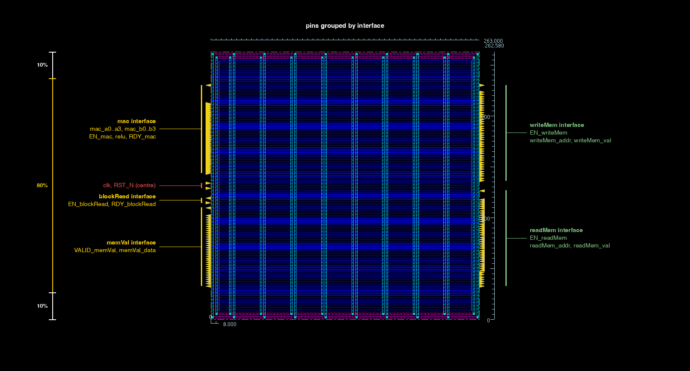</p>

  **Each interface is one group of pins**, so the wires of one handshake stay together. The side that drives the engine (the mac, blockRead and memVal interfaces) is on the left edge, with `clk` and `RST_N` in the middle of it, and the memory ports (writeMem and readMem) are on the right edge. The operands enter on the left, pass through the multipliers and the adder tree, and the results leave on the right to the memory. Keeping `clk` and `RST_N` in the middle lets the clock tree and the reset reach every flip-flop evenly. Use `editPin -spreadType range` with `-start` and `-end` to place each group on its own stretch of the edge.

- **Clock tree:** max transition **1/8 of the period**, max fanout **4**, routed on **Metal4 to Metal7**. The SDC used for CTS drops the clock latency and uncertainty (the tool builds the real tree). `pnr::import` writes that file for you.
- **Routing:** up to **Metal10**, timing and signal-integrity driven, with antenna fixing.
- **Final layout:** meets **setup and hold**, no DRC or connectivity violations, no filler gaps.

### Checking DRC

A **DRC** (design rule check) violation is a shape the foundry cannot build: two wires too close, a wire touching the wrong pin (a **short**), a line end too close to its neighbour. The final layout must have **none**, and no connectivity or antenna violations either.

#### In the reports

`--stage verify` (or a full `bob.py pnr` run) writes three reports to `submission/pnr_reports/`, and `--stage fill` writes the fourth (`checkfiller`). All four must be clean:

| Report | Clean result ends with |
|--------|------------------------|
| `mkMACBuff_500_drc.rpt` | `No DRC violations were found` |
| `mkMACBuff_500_connectivity.rpt` | `Found no problems or warnings.` |
| `mkMACBuff_500_antenna.rpt` | `No Violations Found` |
| `mkMACBuff_500_checkfiller.rpt` | `Total number of 0.200 microns width gap found: 0` |

A failing DRC report lists every violation, with its type, the two nets or pins involved, the layer, and where it is (in um):

```
SPACING: ( ParallelRunLength Spacing ) Regular Wire of Net MULT1/n_627 & Regular Wire of Net MULT1/n_643  ( Metal1 )
Bounds : ( 125.340, 77.110 ) ( 125.460, 77.465 )

SHORT: ( Metal Short ) Regular Wire of Net FE_OFN121_writeMem_val_3 & Pin of Cell t2_out_reg[3]  ( Metal1 )
Bounds : ( 249.435, 207.535 ) ( 249.485, 207.700 )
```

`mkMACBuff_500_drc_before_fix.rpt` is the check `pnr::fill` runs between its two `ecoRoute -fix_drc` repairs. It may list a few violations. Only `mkMACBuff_500_drc.rpt` has to be clean.

#### In the GUI

Load the `fill` (or `verify`) checkpoint, then:

**Step 1.** In the menu bar, click **Verify**, then **Verify DRC...**

<p align="center">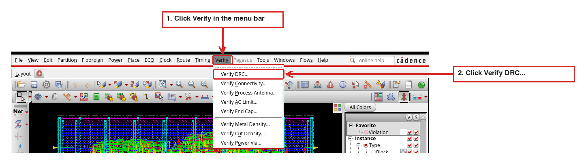</p>

**Step 2.** Leave **Entire area** selected and click **OK**. The result is printed in the console: `Verification Complete : 0 Viols.` when it is clean.

<p align="center">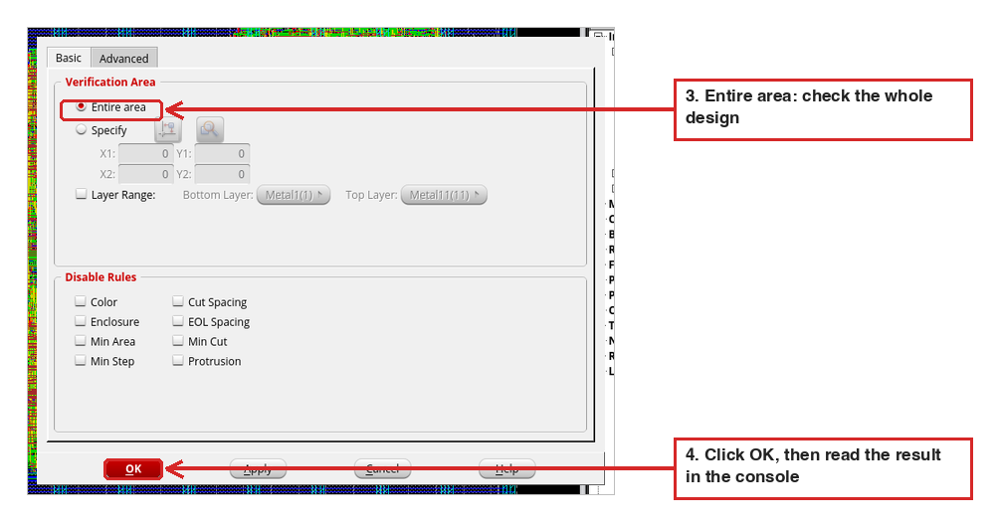</p>

You can also type `verify_drc` at the `innovus>` prompt.

**What a failure looks like.** For the pictures below, one flip-flop of the reference design was moved 0.6 um sideways after routing, so its pins landed on wires of other nets. `verify_drc` then printed `Verification Complete : 10 Viols.`, and every violation shows in the layout as a white **X**:

<p align="center">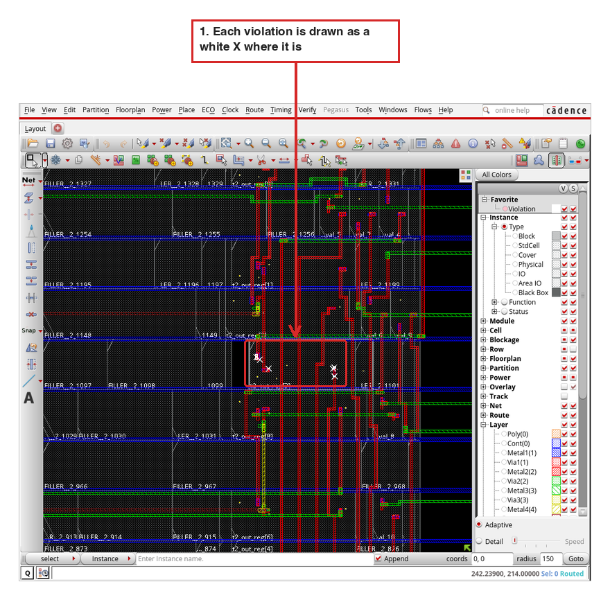</p>

**Step 3.** To go through them one by one, click **Tools**, then **Violation Browser...**

<p align="center">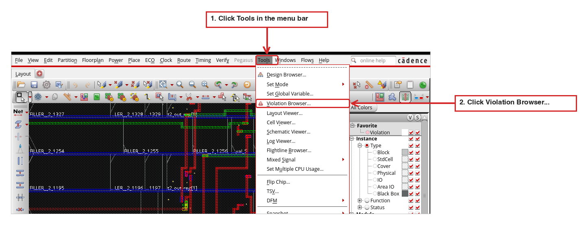</p>

**Step 4.** In the Violation Browser, click a violation type on the left, then a violation on the right. With **Auto Zoom** ticked, the layout zooms to it, and the description says exactly which nets or pins touch.

<p align="center">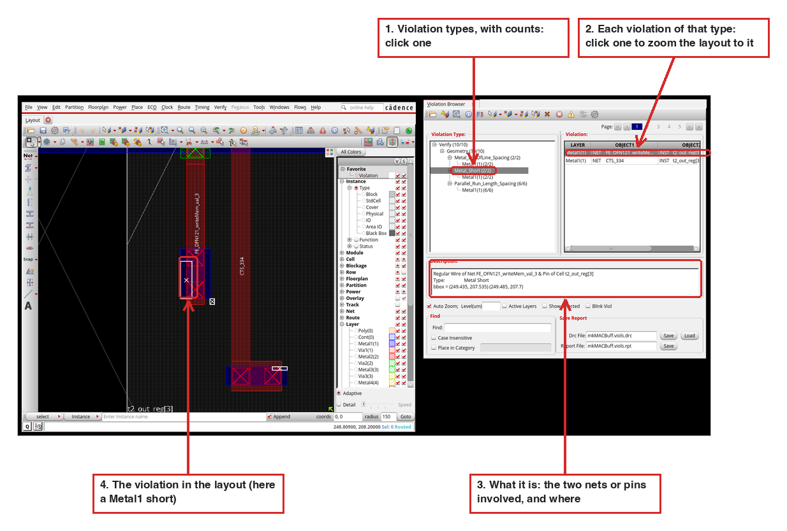</p>

#### Fixing violations

| You see | Try |
|---------|-----|
| A few spacing or short violations after routing | `ecoRoute -fix_drc` (already in `pnr::fill`), then `verify_drc` again |
| Many violations on Metal1 | Keep signal wires off Metal1: `setDesignMode -bottomRoutingLayer 2` before placement |
| Violations everywhere, routing congested | Lower the utilization in `pnr::floorplan` and run from `--stage floorplan` again |
| Connectivity: open nets | Look for an `**ERROR` in the route stage log. A stage that stopped early leaves nets unrouted |

### Checking timing in the GUI

The setup and hold reports in `submission/pnr_reports/` (`postRoute/`, `postRoute_hold/`, `_setup.rpt`, `_hold.rpt`) are the numbers that count. The GUI shows the same paths, and where they are in the layout. Load the `route` (or `fill`) checkpoint, then:

**Step 1.** Click **Timing**, then **Debug Timing...**

<p align="center">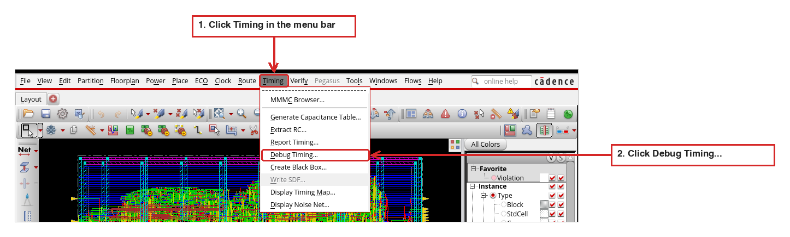</p>

**Step 2.** Pick **setup** (or **hold**) and click **OK**.

<p align="center">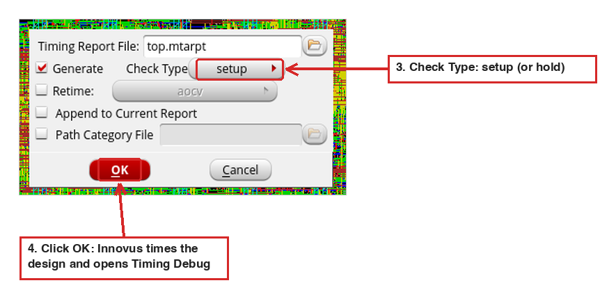</p>

**Step 3.** Timing Debug opens. In the example below there are 132 setup paths, none failing, the worst with +0.282 ns of slack:

<p align="center">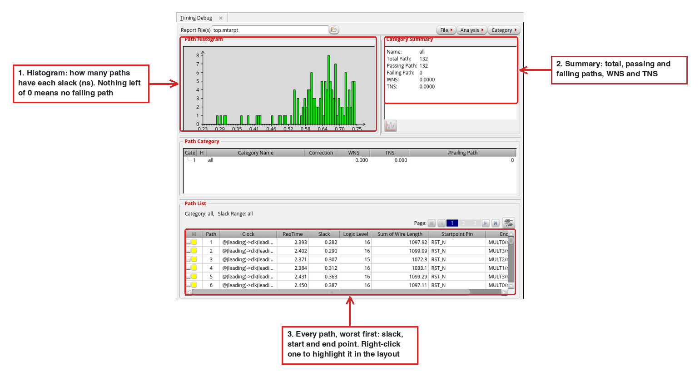</p>

**Step 4.** Right-click a path, then **Highlight > Only This Path** to see it in the layout. A path that crosses the whole die usually means pins or cells in the wrong place.

<p align="center">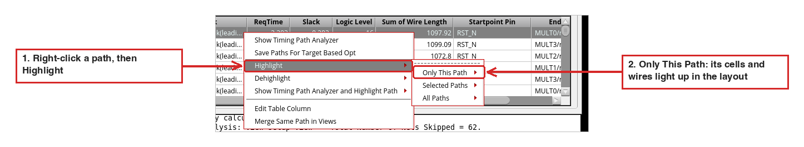</p>

---

## Testbench requirements

Copy the two templates from `starter/tb/` into `submission/testbench/`. Each must print `ALL PASS` when every check passes, and must not print it otherwise.

### `rtl_checker.sv` - top module: `mkMACBuff_tb`

**Your testbench must multiply matrices with your one `mkMACBuff` instance, at least 9 times.** Use `C (8x8) = A (8x4) x B (4x8)`: 64 elements, exactly one fill of the memory.

<p align="center">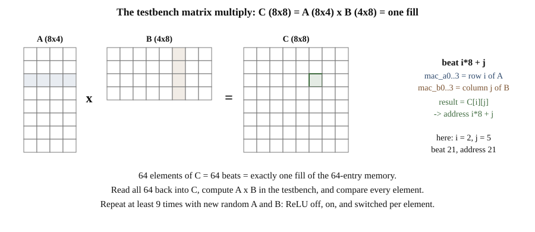</p>

The animation runs one complete matrix multiply: all 64 beats fill `C`, then the testbench compares it with `A x B`:

<p align="center">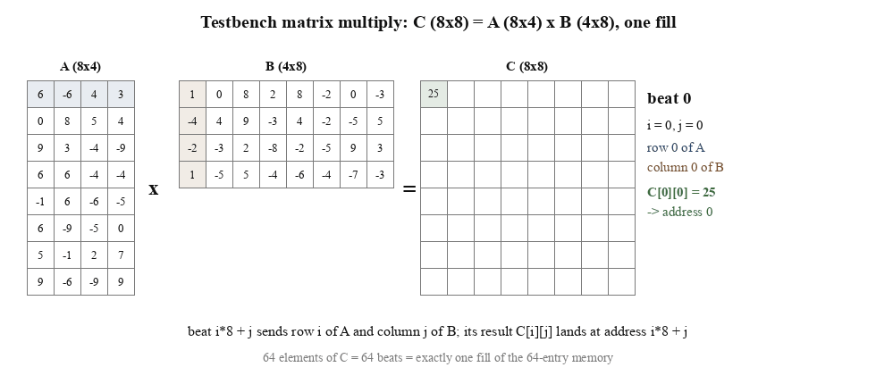</p>

1. Fill `A` and `B` with random signed 16-bit values.
2. Send beat `i*8 + j` as row `i` of `A` on `mac_a0..3` and column `j` of `B` on `mac_b0..3`. Its result is `C[i][j]` and lands at address `i*8 + j`.
3. Read all 64 results back into a `C` array in the testbench.
4. Compute `C = A x B` yourself in the testbench (with ReLU applied when it is on) and compare every element.

Do at least 9 of these, with new random matrices each time and ReLU off, on, and switched per element (for example, on for only some columns of `C`). Also cover:

- Signed boundary inputs on every lane, including the extreme values of the signed range
- A fill where every sum is negative, with ReLU on (all results 0)
- `relu` switched from beat to beat within a fill (each result follows its own beat's `relu`)
- Pauses on both sides, reads only after full, no read and write in the same cycle
- A scoreboard that checks every result against the expected dot product
- **All operand values random**, apart from the boundary cases

### `sdf_checker.sv` - top module: `mkMACBuff_sdf_checker`

Gate-level simulation at **500 MHz** with SDF back-annotation. Its main job is the **post-layout check**: `python3 bob.py timing --run 500 --stage pnr` runs it on the placed and routed netlist, with delays that include the real wires and the real clock tree. That is the netlist that would become a chip, so it is the check that counts most.

Run the same checker on the synthesized netlist first (`--stage syn`). It catches timing problems early, before you spend time on place and route, and a design that fails here will not pass after layout.

Either way, it must fail on a netlist with timing violations and pass one that meets timing.

Match your constraints: drive inputs 1/4 cycle after the rising edge (`set_input_delay`), and sample outputs 1/4 cycle before the next rising edge (`set_output_delay`).

---

## Provided files

**Copy these into `submission/` and edit your copies:**

| File | What you do |
|------|-------------|
| `starter/rtl/mkMACBuff.sv` | Copy to `submission/rtl/` and implement it |
| `starter/scripts/synth.tcl` | Copy to `submission/scripts/` and fill in the TODOs |
| `starter/scripts/pnr.tcl` | Copy to `submission/scripts/` and fill in the TODOs |
| `starter/tb/rtl_checker.sv` | Copy to `submission/testbench/` and write your tests |
| `starter/tb/sdf_checker.sv` | Copy to `submission/testbench/` and write your tests |

**Leave these in `starter/`:** `memory_wrapper_2port.sv`, `registerArray.sv`, `saif2power.tcl`, `vcd2saif_run.csh`.

---

## Submission layout

```
submission/
  rtl/                 mkMACBuff.sv + your multiplier and adder tree (design files only)
  scripts/             synth.tcl, pnr.tcl
  testbench/           rtl_checker.sv, sdf_checker.sv
  syn_reports/         from bob.py synth
  outputs/             from bob.py synth (netlist, SDF, SDC, Genus .dat)
  syn_logs/            from bob.py synth (Genus logs, not graded)
  pnr_reports/         from bob.py pnr
  pnr_logs/            from bob.py pnr (Innovus logs, not graded)
  pnr_outputs/         from bob.py pnr (post-layout netlist and SDF, and checkpoints/ with every stage)
  report/report.md     your report (see Grading > Report), images in report/img/
```

**NOTE:** keep only design files in `submission/rtl/`. Every `.sv` there is compiled, and `bob.py` stops if a module is defined twice, for example by a leftover `mkMACBuff copy.sv`.

---

## Running the flow with `bob.py`

```bash
python3 bob.py check  --run 500               # RTL functional check (your rtl_checker.sv)
python3 bob.py synth  --run 500               # synthesis
python3 bob.py timing --run 500 --stage syn   # SDF check, synthesized netlist
python3 bob.py sim    --run 500               # gate-level sim -> VCD
python3 bob.py power  --run 500               # VCD -> SAIF -> power report
python3 bob.py pnr    --run 500               # place and route
python3 bob.py pnr    --run 500 --stage cts   # one stage only (import, floorplan, ..., finish)
python3 bob.py timing --run 500 --stage pnr   # SDF check, post-layout netlist
python3 bob.py clean                          # delete the files the tools leave behind (--all: also reports and outputs)

**How power is measured.** `bob.py sim` simulates your **synthesized** netlist with your `rtl_checker.sv` and records every signal change in `outputs/mkMACBuff_500.vcd`. `bob.py power` turns that into switching activity and has Genus report the power in `syn_reports/mkMACBuff_500_saif_power.rpt`. For grading we rerun this with **our own testbench**, so every design is measured with the same stimulus. A testbench that barely toggles your design does not lower your power mark. The *initial estimate* in the report table is the power Genus reports right after synthesis (`mkMACBuff_500_power.rpt`), before any simulation.

```

`bob.py check` also warns when the simulator reports a width mismatch on a port connection. That warning usually means an undeclared signal became a 1-bit wire.

---

## Grading

| Component | Marks |
|-----------|-------|
| RTL functional correctness | 25 |
| Post-layout timing: setup and hold met | 10 |
| Clock tree skew | 5 |
| Physical verification: DRC, connectivity, no filler gaps | 10 |
| SDF check, post-layout netlist | 15 |
| **Area (competitive)** | 12.5 |
| **Power (competitive)** | 12.5 |
| Report | 10 |
| **Total** | **100** |

**Deduction:** a width `N` larger than needed costs **10% of the project mark per extra bit**, down to 0 (see Design requirements).


### How each part is graded

#### RTL functional correctness (25)

We run our own grader testbench on the RTL in `submission/rtl/`. It is like your `rtl_checker.sv` but with its own tests: matrix multiplies with random operands, the signed corner cases, ReLU on, off and switched per beat, and pauses on both sides of the handshake. Your marks are proportional to the fraction of results that come out correct. Your RTL must compile with `bob.py check` and follow the multiplier rules in Design requirements. `for` loops are allowed.

#### Post-layout timing (10)

We read your final timing reports, written by the `finish` stage after the last DRC repair: `mkMACBuff_500_setup.rpt` and `mkMACBuff_500_hold.rpt` in `submission/pnr_reports/`. (`postRoute/` is from before the fillers and the DRC repair, so it can differ slightly.) Setup and hold must both be met at 500 MHz: no negative slack and no violating paths.

#### Clock tree skew (5)

We read the skew from `mkMACBuff_500_skew_groups.rpt`. Full marks for a skew below 1/4 of the clock period, that is below 500 ps.

#### Physical verification (10)

We read the reports from the `verify` stage: `mkMACBuff_500_drc.rpt` must report no DRC violations, `mkMACBuff_500_connectivity.rpt` no connectivity problems, `mkMACBuff_500_antenna.rpt` no antenna violations, and `mkMACBuff_500_checkfiller.rpt` no filler gaps.

#### SDF check, post-layout netlist (15)

We simulate your post-layout netlist and SDF (`submission/pnr_outputs/mkMACBuff_500_pnr.v`, `.sdf`) with our own SDF testbench, as `bob.py timing --stage pnr` does with yours. It must pass with no wrong results, and no X on any output once `RST_N` has been released. This is the check that matters most: it is the netlist that would become a chip, with the delays of the real wires and the real clock tree.

#### Area and power (12.5 each)

Competitive: your design is ranked against the class. See Competitive marks below.

#### Report (10)

Graded on the contents listed in Report below. A submission without `submission/report/report.md` gets 0 for the report.

Synthesis has no marks of its own: it is graded through the layout built from it. Your synthesized netlist should still meet timing at 2.0 ns and pass the SDF check, or the layout will not.

### Report (10, required)

Write your report in Markdown as **`submission/report/report.md`**, so it renders on GitHub. Put screenshots and diagrams in `submission/report/img/` and link them with relative paths (``). A submission without `report.md` is incomplete. It must include:

1. Name, student number, project title
2. **A summary table** near the top: synthesized and post-layout area, setup slack after synthesis, setup and hold slack after layout, power (initial estimate and VCD-based), and clock skew
3. **Your width `N`**: the value, the worst-case operands, and the derivation of why that many bits are needed and enough
4. **Design decisions**: the pipeline stages in your multipliers and adder tree, where ReLU sits and why, and the critical path after synthesis and after layout
5. **Diagrams**: a datapath/pipeline diagram showing every stage and the registers between them, and a state diagram for every state machine
6. **Synthesis**: the constraints you applied and why, and your `report_qor` results
7. **Place and route**:
   - the utilization you chose and how you found it
   - timing after each stage (placement, CTS, routing)
   - screenshots **after every stage** (floorplan, power, pins, placement, CTS, routing, fillers), each with (have the ruler on for each stage):
     1. the full layout with the die edge dimensions marked (Innovus rulers)
     2. from placement on: the same layout with the routing layers turned off
     3. the clock tree with the Clock Tree Debugger (CCOpt) window beside it, from placement on (before CTS, with Unit Delay Mode on)
   - the clock tree: maximum and minimum clock latency to the flip-flops, and the skew
   - physical verification: the `verify_drc`, `verifyConnectivity` and `checkFiller` results, and how you fixed any violations
8. **Testbenches**: what each checker tests and how, your matrix-multiply tests, and waveforms comparing the RTL and the post-layout simulation
9. AI-use statement

### Competitive marks: area and power

Area and power are each worth **12.5 marks**, ranked separately against the rest of the class:

- **Area:** the total cell area after place and route, from `mkMACBuff_500_area.rpt` in `submission/pnr_reports/`. Filler cells are not counted, so leaving empty space does not raise your area. Smaller is better.
- **Power:** the VCD-based power from `bob.py power`, rerun with our testbench. Lower is better.

**Who is ranked.** Only designs that pass every functional test, meet setup and hold after layout, and are DRC and connectivity clean are ranked. A small design that does not work is not a good design.

**The curve.** Each ranked design gets a share of the 12.5 marks from its percentile in the class, separately for area and for power. The ranking and the curve below are subject to change, but will be close to this:

| Your rank in the class | Deduction | Marks (of 12.5) |
|------------------------|-----------|-----------------|
| Top 10% | none | 12.5 |
| Top 10% to 25% | 30% | 8.75 |
| Top 25% to 50% | 40% | 7.5 |
| Top 50% to 75% | 50% | 6.25 |
| Bottom 25% | 80% | 2.5 (the minimum) |

Ranks are percentiles of the ranked designs, best first, with each boundary in the better band (a design exactly at the 10% mark gets 12.5). Ties share the better band. Every ranked design receives at least **2.5** marks for each of area and power, as long as its area is within the 50,000 um^2 limit (over it, area is 0) and its power is measured correctly. A design that is not ranked (it fails a functional test, timing after layout, DRC or connectivity) receives **0** for both. For example, a design in the top 10% for area and in the top 25% to 50% for power receives 12.5 + 7.5 = 20 of the 25 competitive marks.

### Finishing early at the midpoint

If your **MIDPOINT** submission (tagged by **December 1st, 11:59 PM**) passes everything, you may stop there:

- all functional tests pass (grader testbench)
- synthesis meets timing at 2.0 ns
- after layout, setup and hold are met, and DRC and connectivity are clean with no filler gaps
- both SDF checks pass (synthesized and post-layout netlists)

Then your MIDPOINT counts as your **final submission**, and you receive the **full competitive marks** for area and power. That is a treat for finishing early, so get started as soon as you can. The rest of the marks are graded as usual. Your MIDPOINT must include `report.md`. 

If your MIDPOINT is complete but does not pass everything, it is free feedback as in Project 2, and you continue to the final deadline (**December 15th, 11:59 PM**). You may also keep improving after a passing MIDPOINT and submit a FINISH tag instead. The FINISH is then graded and ranked like everyone else's.

---

## Submitting

### Repository setup

As in Project 2, the teaching staff create a **private** repository for you in the course organization, named **`elec402-p3-2026-<firstname><lastname>`** (all lowercase), with the starter files in it. Accept the GitHub invitation if you get one, then clone it and work in it:

```bash
git clone git@github.com:ubc-elec402-2026/elec402-p3-2026-<firstname><lastname>.git
```

Do not create a repository yourself, and do not copy it outside the course organization. Only the repository we create is graded.

### Tagging your submission

```bash
python3 submit.py start      # once, when you start: records your start timestamp
python3 submit.py midpoint   # midpoint submission, by December 1st, 11:59 PM
python3 submit.py finish     # final submission, by December 15th, 11:59 PM (re-running before the deadline moves the tag)
```

Each command stages your work, commits it, and pushes the matching tag (`START`, `MIDPOINT`, `FINISH`). The version tagged **FINISH** at the deadline is graded, unless your MIDPOINT already passes everything (see Grading > Finishing early at the midpoint).

Push `START` when you begin, `MIDPOINT` by December 1st and `FINISH` by December 15th (unless your MIDPOINT is your final submission, see Finishing early):

| Tag | Deadline | Must contain |
|-----|----------|--------------|
| `START` | when you start | your starter repository |
| `MIDPOINT` | **December 1st, 11:59 PM** | the complete flow: RTL, scripts, testbenches, synthesis and place-and-route results (including every stage's checkpoint), and `submission/report/report.md` |
| `FINISH` | **December 15th, 11:59 PM** | everything in MIDPOINT |

If your MIDPOINT passes everything and you stop there, you do not push FINISH: your MIDPOINT is graded as your final submission.


`submit.py` refuses to push a tag that is missing required files.

---

## Academic misconduct

This is an individual project. The work you submit must be your own.

- You may not copy another student's code or collaborate on your implementation. Do not share your code, your scripts, your testbenches, your layout or your report with anyone, and do not look at anyone else's.
- Any Piazza post that contains code, parts of a solution, or details of your implementation must be **private** (visible only to the instructors). Keep public posts to general, non-solution questions.
- Do not fork your repository, make it public, or publish your work anywhere (GitHub, a personal website, a portfolio, or any other public place), during or after the course.
- Do not post your MIDPOINT feedback or test results publicly in any form. Questions about a test case go in a private post.
- Editing your reports or results to make a design look like it passes when it does not - for example, doctoring the synthesis or place and route reports, the timing numbers, the DRC results, the screenshots, or the testbench output - is cheating and may result in a grade of **0** on the project.
- You must disclose any AI use in the AI-use statement in your report. Failing to list it is treated the same as the above and may result in a grade of **0**.

Suspected misconduct will be reported to the department and handled under UBC's academic integrity policy. You are of course encouraged to use the course material, discuss concepts at a high level, and ask the teaching staff when you are stuck.

### Use of AI and autonomous agents

AI/LLM tools may be used as learning and debugging aids. For example, you may ask an AI system to explain concepts, SystemVerilog or Tcl syntax, CAD-tool error messages, timing reports, or to suggest debugging approaches and test cases.

You may not delegate completion of the project to an autonomous agent. In particular, you may not give an AI agent the project directory and instruct it to create or modify the design, run the CAD tools, iteratively debug the design, or generate the final project deliverables on your behalf.

You remain responsible for the design and for every submitted file. You must be able to explain your RTL, testbenches, scripts, layout, design choices, and CAD results, and to reproduce a result or make a small modification if requested by the teaching staff. At the end of your report, include a brief AI-use statement identifying the tools used and how they were used. Detailed chat transcripts are not required. Any submission may be selected for a brief verification discussion or demonstration.

---

## Help and resources

Running out of disk space on ssh-soc? See [Appendix B](docs/DISK_SPACE.md).

Course resources on Piazza:

- [class-recording-PNR-basicFlow.mp4](https://piazza.com/class_profile/get_resource/mtrn3b5ftci570/mtrn3jvh39h5j0)
- [class-recording-PNR-tillPlacement.mp4](https://piazza.com/class_profile/get_resource/mtrn3b5ftci570/mtrn3l13wom5l0)
- [class-recording-PNR-tillCTS.mp4](https://piazza.com/class_profile/get_resource/mtrn3b5ftci570/mtrn3m2bhtq5me)
- [class-recording-PNR-tillFillers.mp4](https://piazza.com/class_profile/get_resource/mtrn3b5ftci570/mtrn3n5n43f5nm)
- [class-recording-PNR-fillers.mp4](https://piazza.com/class_profile/get_resource/mtrn3b5ftci570/mtrn3o4e4i05or)
- [PNR slides](https://piazza.com/class_profile/get_resource/mtrn3b5ftci570/mtrn3jj1g5d5i6)

---

Good luck!
