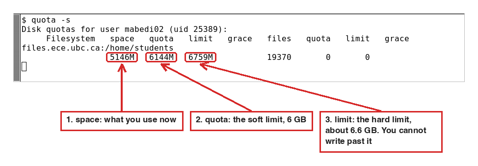
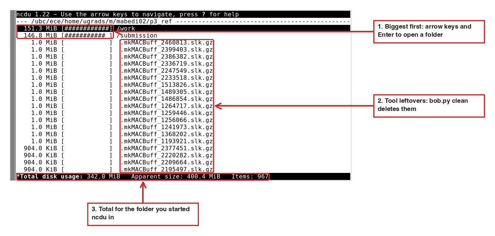

# Disk space on ssh-soc

Your undergraduate ECE account has a **hard limit of about 6.6 GB**, and it cannot be raised. When you reach it, the tools fail in confusing ways: Innovus cannot save a checkpoint, a simulation stops writing its VCD, or `git` cannot commit. Check your space before a long run, and clean up early.

## 1. See how much you use

```bash
quota -s
```

<p align="center"></p>

## 2. Find what is using it

`ncdu` lists folders biggest first. Start it in your home folder:

```bash
ncdu ~
```

<p align="center"></p>

| Key | Does |
|-----|------|
| Up / Down, Enter | Move, open a folder |
| Left | Back up one folder |
| `d` | Delete the selected file or folder (it asks first) |
| `q` | Quit |

## 3. Usual culprits

| Folder | What it is | What to do |
|--------|------------|------------|
| `~/.vscode-server` | Left by VS Code Remote-SSH. It can reach several GB, with an old copy for every VS Code update | Delete it. VS Code puts back what it needs the next time you connect |
| `work/`, `*.vcd`, `*.wlf` in your repository | Simulation libraries and waveforms | `python3 bob.py clean` |
| `.mkMACBuff_*.slk.gz`, `innovus.log*`, `genus.log*` | Leftovers from every Innovus and Genus run | `python3 bob.py clean` |
| `submission/pnr_outputs/checkpoints/` | A saved design for every place-and-route stage | Delete it when you are done with the GUI. `bob.py pnr` makes it again |
| Old copies of your projects, `~/.cache`, `~/.local/share/Trash` | | Delete what you no longer need |

`python3 bob.py clean --all` also deletes the generated reports and outputs (it asks first). Run it only after you have committed what you need.
