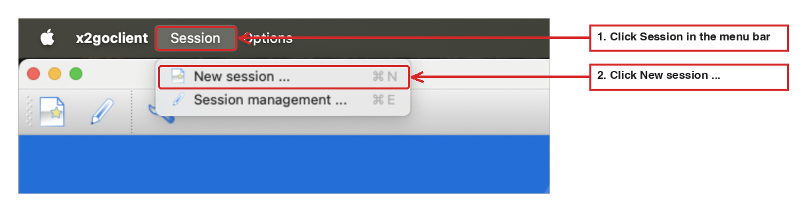
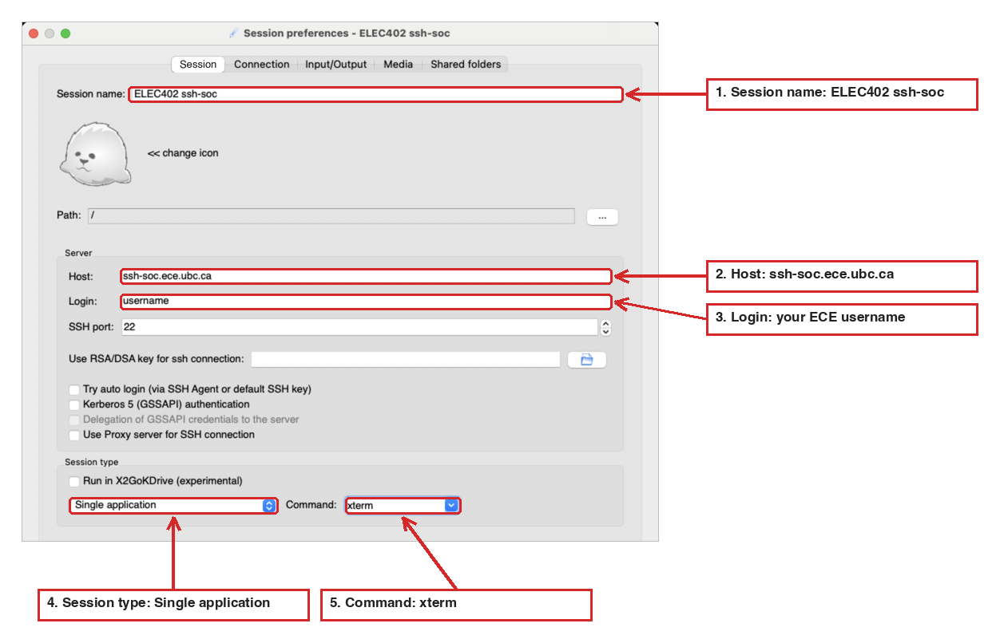
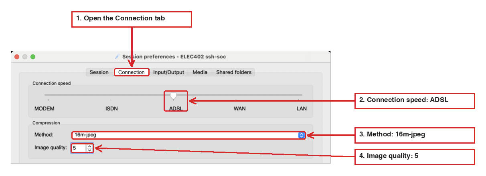
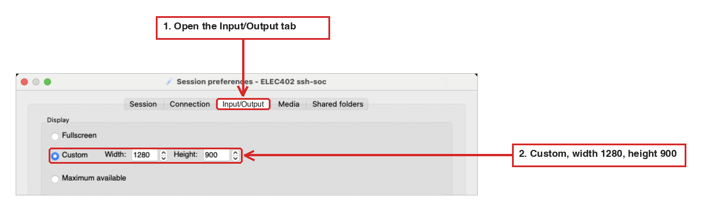
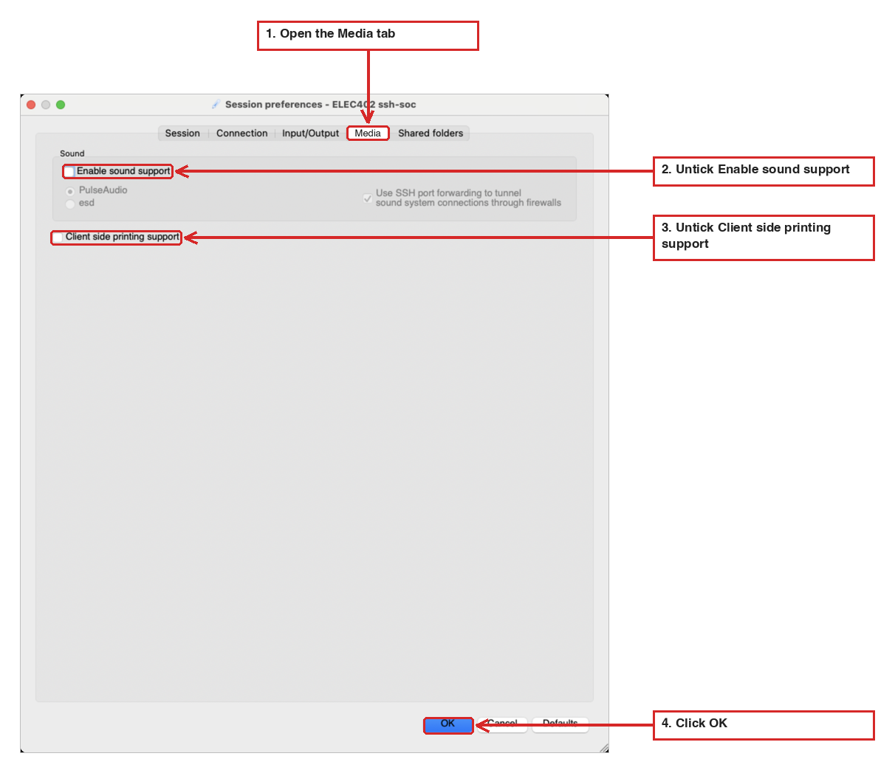

# Using the Innovus GUI with X2Go

X2Go shows the Innovus GUI on your own computer and stays fast over the network. Set it up once as below.

**IMPORTANT:** off campus, connect to the UBC VPN first (myVPN / Cisco Secure Client). `ssh-soc.ece.ubc.ca` cannot be reached from outside UBC without it.

## 1. Install the client

| Your computer | Install |
|---------------|---------|
| macOS | [XQuartz](https://www.xquartz.org/) first (log out and back in after installing it), then the [X2Go client](https://wiki.x2go.org/doku.php/download:start) |
| Windows | The [X2Go client](https://wiki.x2go.org/doku.php/download:start) |
| Linux | `x2goclient` from your package manager |

## 2. Create the session

**Step 1.** Open X2Go Client. In the menu bar, click **Session**, then **New session ...**

<p align="center"></p>

**Step 2. Session tab.** Fill in the name, the host and your login, and set the session type to **Single application** with the command `xterm`. Leave SSH port at `22`.

<p align="center"></p>

**Step 3. Connection tab.** Connection speed **ADSL**, compression method **16m-jpeg**, image quality **5**.

<p align="center"></p>

**Step 4. Input/Output tab.** Display **Custom**, width `1280`, height `900` (or a bit smaller than your screen).

<p align="center"></p>

**Step 5. Media tab.** Untick **Enable sound support** and **Client side printing support**, then click **OK**.

<p align="center"></p>

Leave every other setting at its default. The session now appears as a card in the X2Go Client window.

## 3. Start Innovus

1. Click the session and log in. An `xterm` window opens on your screen. On macOS it appears through XQuartz: click the XQuartz icon in the Dock if you do not see it.
2. In that `xterm`, go to your repository and start Innovus:

   ```bash
   cd ~/elec402-p3-2026-<firstname><lastname>
   source /CMC/scripts/cadence.innovus21.17.000.csh
   innovus
   ```

   The `xterm` is now your `innovus>` console, and the layout window opens beside it.

3. Load the stage you want to look at (run it with `bob.py` first):

   ```tcl
   restoreDesign submission/pnr_outputs/checkpoints/mkMACBuff_500_route.enc.dat mkMACBuff
   ```

   Replace `route` with `floorplan`, `power`, `pins`, `place`, `cts` or `fill` for the other stages.

## 4. When you are done

Type `exit` in the Innovus console, then close the `xterm`. The session ends by itself. If you only close the X2Go window, the session is suspended and keeps running on the server.
